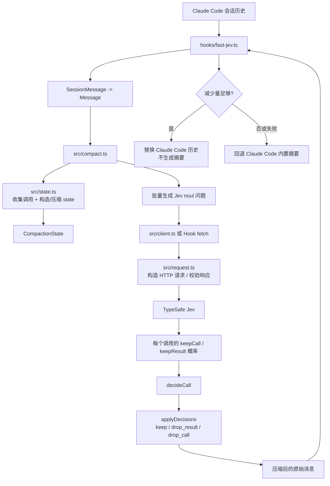
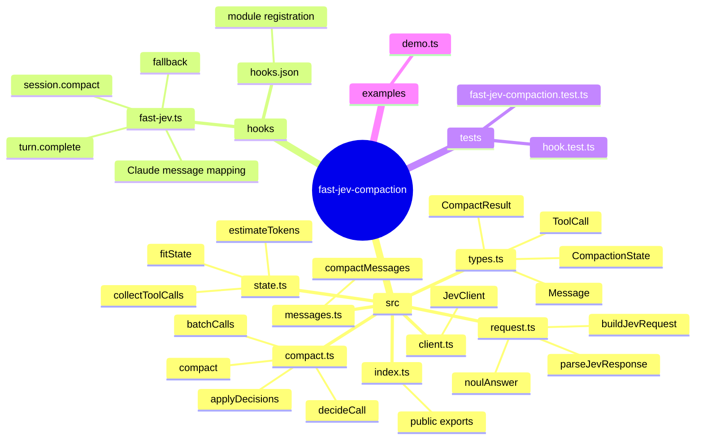
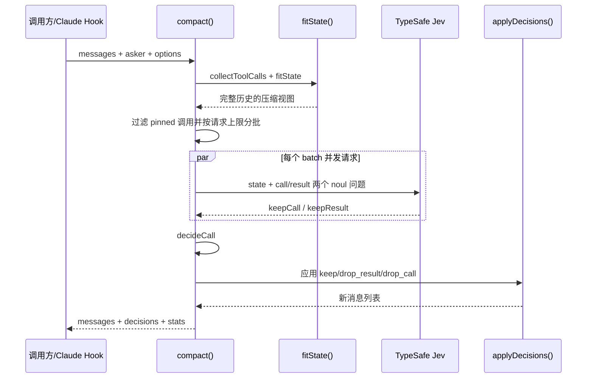

# fast-jev-compaction 项目导览

本文用于快速建立项目心智模型。项目的核心目标是：**不改写用户/助手文本，只根据 Jev 对工具调用和工具结果的判断，删除或截断已经不需要的工具历史**。

源码中的新增说明注释统一使用中文，便于中文开发者直接阅读和维护。

## 一、整体思维图



## 二、源码模块关系



## 三、一次 compact 的时序



## 四、核心概念

### 1. pinned（固定消息）

- 第一条消息永远固定，通常包含任务约束。
- 最新 `preserveRecentMessages` 条消息固定，避免压缩正在进行的工作。
- 一个工具调用只要调用消息或结果消息落在固定区，就整体视为 pinned。

### 2. state 与 output 是两套视图

`fitState()` 生成的 state 只是给 Jev 判断用的输入：

- 工具结果替换为 `ok/error, N chars (omitted)`，避免把大量结果重复发送给 Jev。
- 超长输入和文本会按阶段压缩。
- 用户/助手文本在最终输出中不会被 state 的压缩版本替换。

最终输出由 `applyDecisions()` 基于原始消息重建，因此可以做到“决策有损，保留内容尽可能原样”。

### 3. 一个调用有两个独立决策

```text
keepResult >= keepThreshold -> 保留调用和完整结果
否则 keepCall >= keepThreshold -> 保留调用，结果保留头部 + 截断说明
否则 -> 删除调用及其结果
```

这比只有一个“保留/删除”判断更细：调用记录本身可能仍有审计价值，但完整输出已经可以重新读取或重新执行。

### 4. 空间预算是两层

- `maxStateTokens`：控制发送给 Jev 的历史 state。
- `maxRequestTokens`：控制 state 加问题的单次请求。

当问题太多时，state 会在每个 batch 中重复发送；这是为了让每批问题都拥有完整上下文，同时请求会并发执行。

## 五、建议阅读顺序

1. `README.md`：先了解产品目标、约束和默认配置。
2. `src/types.ts`：掌握领域对象和输入输出结构。
3. `src/compact.ts`：理解主流程和三种决策动作。
4. `src/state.ts`：理解工具配对、固定规则和 state 压缩阶梯。
5. `src/request.ts`、`src/client.ts`：理解 Jev HTTP 边界。
6. `hooks/fast-jev.ts`：理解 Claude Code 插件适配、自动触发和回退策略。
7. `tests/`：通过测试确认边界行为，尤其是对象复用、消息映射和预算分批。

## 六、开发时的风险点

- 不要把 Jev 的 state 截断文本直接写回最终会话；最终输出必须走 `applyDecisions()`。
- 不要让 tool result 脱离对应的 tool call；删除调用时必须同时删除结果。
- 修改消息重建逻辑时，注意 Claude Code 的 `handle`：未改变的消息应尽量复用原对象，改变后的消息需要去掉旧 handle。
- 修改 fitting 顺序会改变 Jev 看到的上下文，应同步更新测试和 README。
- 没有 API key、Jev 返回异常、历史无法塞入预算、减少量不足时，都必须回退内置摘要，而不是返回不完整历史。
